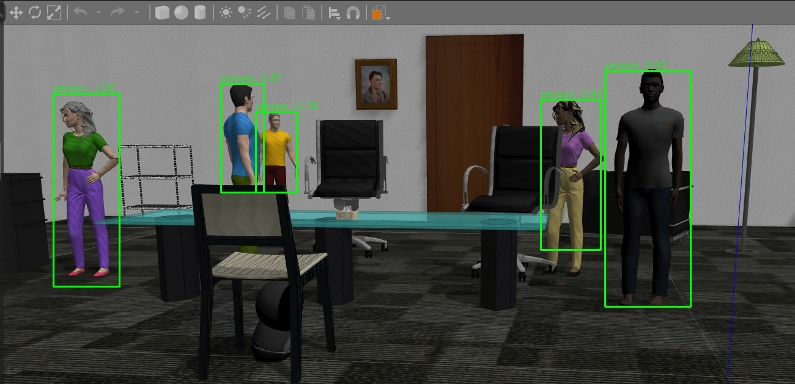

# Jackal Person Detection

<p align="center">
    
    
    
        
    
</p>

<p>Este projeto implementa a detecção de pessoas utilizando o modelo YOLO (You Only Look Once) em um robô Jackal. O robô utiliza uma câmera para capturar imagens e identificar a presença de pessoas em tempo real. Quando uma pessoa é detectada, o robô pode tomar decisões de navegação para evitar colisões ou desviar da pessoa detectada.</p>

## Funcionalidades

- **Detecção de Pessoas**: Utiliza a rede neural YOLO para detectar pessoas em tempo real nas imagens capturadas pela câmera frontal do robô Jackal.
- **ROS (Robot Operating System)**: O projeto é desenvolvido utilizando ROS, que gerencia os tópicos e mensagens entre os diferentes componentes do sistema.
- **Integração com OpenCV**: Utiliza a biblioteca OpenCV para processar imagens e aplicar a detecção de objetos utilizando YOLO.
- **Autonomia do Robô**: O robô Jackal pode reagir à presença de pessoas e ajustar sua navegação para evitar colisões ou desviar delas, dependendo da situação.

## Tecnologias Utilizadas

- **Python**: Linguagem principal para a implementação do código e integração com ROS.
- **ROS**: Sistema operacional de robô utilizado para comunicação entre os módulos do sistema, como captura de imagens e controle de movimento.
- **YOLO**: Algoritmo de detecção de objetos, especificamente usado para detectar pessoas nas imagens.
- **OpenCV**: Biblioteca para processamento de imagens, usada para converter imagens de ROS para OpenCV e realizar a detecção com YOLO.
- **CVBridge**: Pacote do ROS que facilita a conversão de imagens entre ROS e OpenCV.

## Como Executar

1. Instale as dependências necessárias:

```bash
pip install opencv-python
pip install cv_bridge
```

2. Clone o repositório:

```bash
git clone https://github.com/GerlianeChaves/SocialNavigation.git
```

3. Entre no diretório do projeto:

```bash
cd SocialNavigation
```

4. Instale as dependências do ROS:

```bash
rosdep install --from-paths src --ignore-src -r -y
```
5. Inicie o ROS Master e o ambiente de simulação:

```bash
roscore
```

6. Execute o nó do Jackal para iniciar a detecção de pessoas:

```bash
rosrun jackal_move human_detection_oficial.py
```

## Exemplo de Execução
Quando o código for executado, o robô Jackal começará a capturar imagens e processá-las para detectar a presença de pessoas. Se uma pessoa for detectada, a navegação do robô pode ser ajustada para evitar colisões ou desviar dela, dependendo da lógica que for implementada.

## Resultados

<p align="center">  </p> <h3 style="color: #f8f9fd;">


## Contribuindo

Pull requests são bem-vindos. Para mudanças significativas, abra uma issue primeiro para discutir o que deseja alterar.

Por favor, atualize os testes conforme necessário.

## Licença

[MIT](https://choosealicense.com/licenses/mit/)
